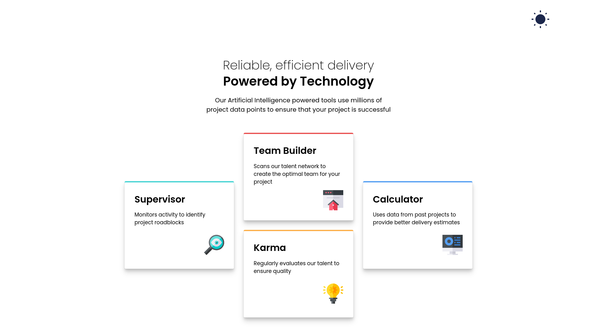
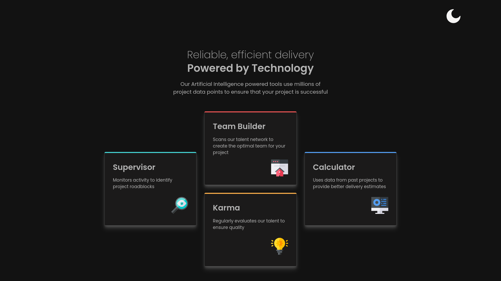
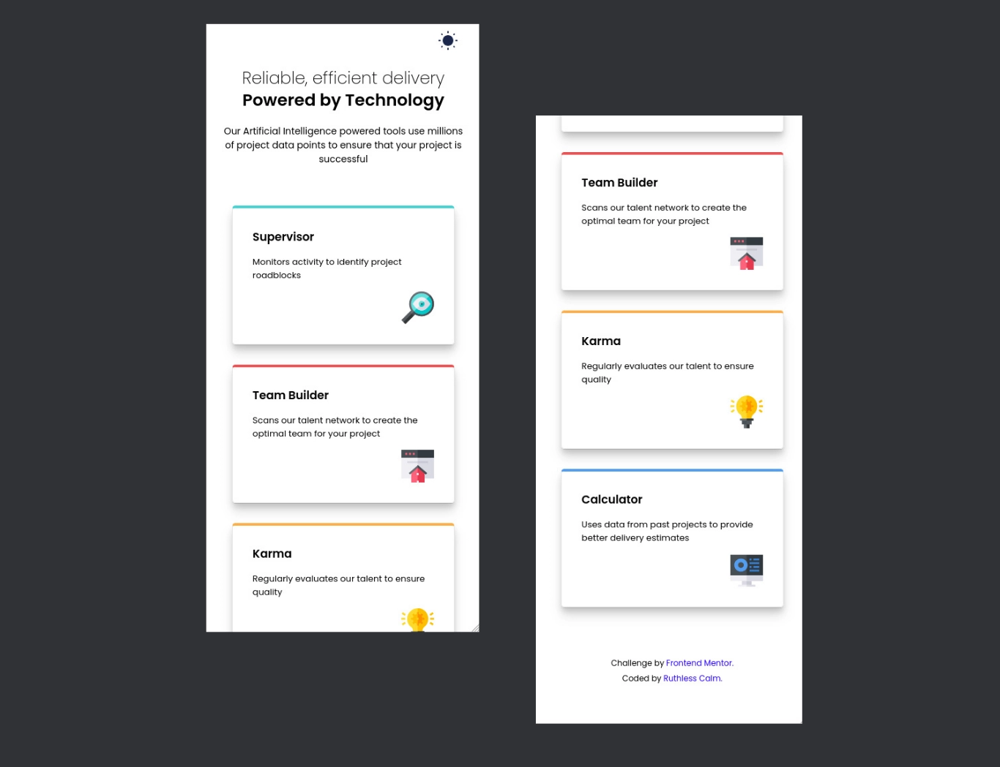

# Four Card Feature Section

This is one of my Frontend Mentor challenge projects.

## Links

This is the challenge - [Four Card Feature Section](https://www.frontendmentor.io/challenges/four-card-feature-section-weK1eFYK)

* Live Demo: [Four Card Feature Section](https://ruthlesscalm.github.io/fm-four-card-section/)

## Preview

* **Desktop Light**

* **Desktop Dark**

* **Mobile**

## Features

* Fully fluid and responsive layout (280px to 1920px)
* Accessibility-focused (semantic HTML, focus states, screen reader friendly)

## Tech Stack

* HTML
* CSS
* JavaScript

## Credits / References

* [Joshua Comeau](https://www.joshwcomeau.com/)
  * [Shadow Palette](https://www.joshwcomeau.com/shadow-palette/)
  * [Box Shadow Techniques](https://www.joshwcomeau.com/css/designing-shadows/)
  * [Modern CSS Reset](https://www.joshwcomeau.com/css/custom-css-reset/)
* [Piccalilli - Andy Bell](https://piccalil.li/author/andy-bell/)

  * [Modern CSS Reset](https://piccalil.li/blog/a-more-modern-css-reset/)
* [Tobias Ahlin Bjerrome](https://tobiasahlin.com/)

  * [Box Shadow Techniques](https://tobiasahlin.com/blog/layered-smooth-box-shadows/)

## License

This project is licensed under the MIT License.

Feel free to use the code for learning, experimentation, or reference.
